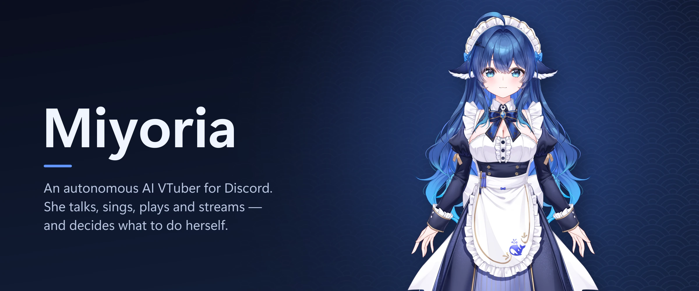

> [!WARNING]
> **Work in progress, early stage.** Miyoria changes daily and breaks often: configs, the database schema and the CLI can change without notice, and parts of the setup still assume the author's own machine. It is not recommended for use yet.

<p align="center">
  
</p>

Miyoria
=======

**An autonomous AI VTuber for Discord. She chats, joins voice, sings song requests, plays Minecraft and goes live, and she decides what to do herself, inside the guardrails you set.**


## From an empty folder to her first reply

You need Node.js 24 and a Discord bot token. Everything else has a default.

```bash
npx miyoria@latest init       # writes miyoria.toml, .env and profiles/: LLM endpoint, API key, model, Discord token
npx miyoria doctor            # checks the config, the character, the LLM, Discord and the database
npx miyoria chat              # talk to her in the terminal, no Discord needed
npx miyoria core              # the Discord bot, her mind loop and the admin panel at http://127.0.0.1:7878/
npx miyoria stage             # on the streaming PC: VTube Studio, OBS and the overlay
npx miyoria stage obs-setup   # builds her OBS scenes and sources (add --dry-run to preview)
```

Her data lives in `data/miyoria.db` (SQLite through `node:sqlite`, so there is no database to install). `npx miyoria config` changes settings one at a time. `miyoria status`, `miyoria decisions` (why she spoke or stayed quiet) and `miyoria events 'agent.*'` let you watch a running Core. `npx miyoria --help` lists everything.

## 多台電腦:角色、安裝和啟動

服務分成三個角色,每台電腦只跑你選的那些(名稱集中在 `packages/cli/src/stack/roles.ts`,之後要改只改那裡):

| 角色 | 服務 | 說明 |
|---|---|---|
| `broadcast`(直播機) | `voice-node`、`stage` | Discord 語音 + Go Live、VTube Studio / OBS / overlay。OBS、VTube Studio、遊戲也在這台,但不由 Miyoria 啟動 |
| `core`(Bot 服務機) | `core`、`turn` | Discord bot、所有模組、資料庫、管理面板(:7878);`turn` 是判斷講完的 worker(`vad_engine = "silero"` 用);檔案沙箱要 Docker |
| `inference`(GPU 推論機) | `asr`、`tts`、`sing` | 全部 AI 模型;三個要在同一台,因為 sing 做歌時要它們讓出顯卡 |

在原始碼資料夾裡(`pnpm dev <指令>` 等於 `miyoria <指令>`):

```bash
miyoria init                  # 第一題:這台電腦跑什麼(單機全部、只有一個角色、或自訂);多台電腦時再問各角色的區網位址
miyoria init --yes --roles inference --inference-host 192.168.1.20   # 不互動版(--roles:all、角色或服務名稱,可逗號分隔)
miyoria install --dry-run     # 只安裝這台電腦需要的:node 套件和建置、每個 worker 的 venv 與 pip;最後列出要手動下載的
miyoria install
miyoria doctor                # 這台電腦的角色缺什麼:套件、venv、模型檔、Docker、其他電腦的位址和連線
miyoria start --dry-run       # 會開哪些分頁、哪些已在執行而略過
miyoria start                 # 這台電腦設定的角色;每個服務一個 Windows Terminal 分頁
miyoria start inference       # 或指定角色 / 服務:broadcast、core、inference、all、asr、tts ...
```

`miyoria start` 每個服務開一個分頁(同一個 Windows Terminal 視窗 `miyoria`),看得到輸出,要停就關分頁或在裡面按 Ctrl+C。已經在回應健康檢查、埠上有程式、或分頁還開著的服務不會再開第二份;不會自動重啟,也不會停任何服務。推論機會先開 asr、tts,等它們就緒再開 sing。`miyoria up` 是另一個選擇:背景執行、日誌寫檔、Ctrl+C 一起停,兩個指令都讀同一份 `[machine]`。

設定存在 `miyoria.toml`(不進 git):

```toml
[machine]
roles = ["core"]               # broadcast | core | inference,可以多個;單機 = 三個都寫
# services = ["core", "asr"]   # 自訂:直接列服務,寫了就取代 roles
[machine.hosts]
core = "192.168.1.10"          # 跑 core 的電腦:core 綁這個位址(admin API / voice.link / stage.link),直播機連它
inference = "192.168.1.20"     # 跑 asr / tts / sing 的電腦:worker 綁這個位址,core 連它
```

全部在同一台時兩個位址都是 `127.0.0.1`(預設)。分開時 `miyoria init` 會把位址寫到用得到的地方:Core 的 `bind`、stage 的 `core_url`、`.env` 的 `ASR_URL` / `TTS_URL`、`[modules.sing] url`;直播機要用 core 那邊的 `STAGE_LINK_TOKEN` / `VOICE_LINK_TOKEN`(init 會請你貼上),voice node 另外要在 `apps/voice-node/.env` 填 `SELF_TOKEN`。分開跑還有兩件事沒處理(見 [backlog](docs/design/backlog.md)):歌曲影片是推論機上的本機路徑,Minecraft 擴充在 core 那台開遊戲。

沒有 `[machine]` 的舊設定檔行為不變。

## Autonomy at a glance

Commands are overrides, not the main way to drive her. She runs a mind loop: she notices who is around, what people are doing and how she feels, then decides to talk, join voice, start a stream, switch scenes, play a game or sing. Every action goes through a gate. Low-risk actions run straight away. Risky ones she reviews herself first, and she only asks the owner when she has doubts.

You set the limits, and she chooses inside them:

```toml
[modules.agent]
default_mode = "quiet"        # text channels: off | mention-only | quiet | normal | lively — a ceiling, not a script

[modules.sing]
start = "decide"              # she picks the moment; a requested song starts on its own if she lets every reminder pass
```

`/admin autonomy pause` stops her mind loop at once. `/me privacy` lets anyone opt out of DMs or of being approached. Text from other people (chat lines, song titles, web content) always reaches the model as quoted data, never as instructions.

## What she does

| Area | What she does |
|---|---|
| Chat | Replies when addressed, joins in when she wants to (within the channel's level), and remembers people, nicknames and how much she likes them |
| Voice | Listens with Qwen3-ASR, answers with a cloned Qwen3-TTS voice (she can speak Japanese while subtitles stay Chinese), and handles barge-in |
| Stream | Goes live on Discord through OBS, drives a Live2D model in VTube Studio (emotions, gestures, lip sync, idle motion), and picks OBS scenes |
| Singing | Turns a song request (YouTube or a local file) into a cover in her voice (Demucs + Seed-VC), sings it with lyrics on the overlay, and shows the original video |
| Games | Plays Minecraft 1.21.1 legitimately through a Fabric bridge and Baritone (no x-ray, real progression, crafting), with live commentary |
| Overlay | An OBS browser source with typewriter subtitles, an emotion dot, live status, the request queue and voice bars along the left edge |
| Extensions | TypeScript extensions, MCP servers, and sandboxed tools she can write and propose herself |

## Nodes at a glance

Core, the speech workers, the voice node and the Stage node talk over WebSocket and HTTP, so they can share one PC or be split across machines.

```
packages/         The Core modules (@miyoria/*): kernel, agent, mind, self, world, memory, voice, stage, sing, game, ...
apps/panel        Admin panel (React + shadcn/ui), served by Core on :7878
apps/overlay      OBS browser-source overlay, served by the Stage node on :7884
apps/voice-node   Self-account voice node: Discord voice and Go Live streaming
workers/          Python GPU workers: asr (:8003), tts (:8002), sing (:8005), plus fakes for testing
extensions/       The Minecraft bridge mod and adapter, and example extensions
profiles/         Characters: persona, voice, avatar mapping (the first one is DeepSeek-chan)
deploy/           Dockerfile and Compose files for Core and the speech workers
docs/             Architecture, design notes, protocols, decisions and the roadmap
```

## Guides

- [Architecture](docs/ARCHITECTURE.md): node topology, the kernel and module model, agent, memory, social, queue, extensions, voice, stage, games.
- [Autonomy design](docs/design/autonomy.md): the mind loop, the action gate, guardrails, and the record of each phase as it shipped.
- [Operations](docs/OPERATIONS.md): deployment layouts, ports, Docker, upgrades, backups, logs, and a security checklist.
- [Speech workers](workers/README.md): ASR, TTS and singing on a GPU, and the fake workers for running without one.
- [Voice node](apps/voice-node/README.md): the self-account voice client and Go Live.
- [Stage link](docs/protocols/stage-link.md): VTube Studio, OBS scenes, the overlay, lip sync and song videos.
- [Minecraft](extensions/minecraft/README.md): the bridge mod, Baritone settings and what she can do in game.
- [Decisions](docs/DECISIONS.md) and [Roadmap](docs/ROADMAP.md): why things are the way they are, and what is next.

## Building from source

Only needed to work on Miyoria itself. You need Node.js 24 and pnpm 9 (`corepack enable`). The workers need Python 3.11 and, for real speech and singing, an NVIDIA GPU.

```bash
pnpm install
pnpm dev init                 # same as `miyoria init`; tsx runs packages/cli/src directly, no build step
pnpm dev:core                 # same as `miyoria core`
pnpm typecheck && pnpm lint && pnpm test
pnpm build:web                # admin panel and overlay
pnpm --filter miyoria build   # the npm package (esbuild) in packages/cli/dist/
```

`pnpm dev <command>` is the same as `miyoria <command>`.

## Status

Every phase on the [roadmap](docs/ROADMAP.md) is implemented. Since November 2026 she has run live on a real Discord server: voice chat, Go Live, VTube Studio, OBS, singing and Minecraft. Rough edges are tracked on the roadmap. The rewrite from the original Rust prototype is complete; the prototype is still in the git history.

## License

No license has been chosen yet, so all rights are reserved for now.

Original illustration: 神宫凉子 (Kamiya_Ryoko). The banner uses the illustration from the free [DeepSeek-chan Live2D model and layered PSD](https://vgen.co/KAMIYA/product/deepseek-chan-deepseek-free-live2d-model-layered-psd-psd/1c55a71a-2747-4616-819d-2dc0a934089d), credited as its usage guidelines ask; Miyoria did not create the illustration or the model. The model files, the PSD and her voice reference are licensed separately and are not part of this repository.
